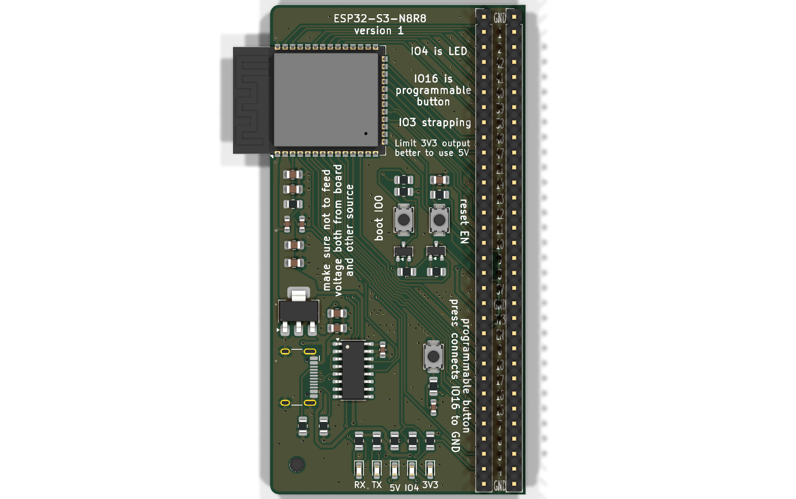
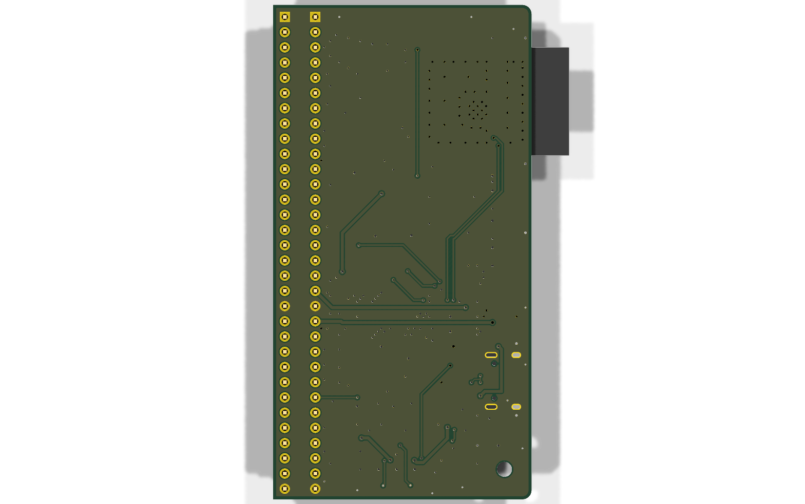

# ESP32-S3 Motherchip

A platform for testing esp32 and components with it. To later be able to make optimized products.

## esp32-hat

| Board                                       | Description               | Status                  |
|---------------------------------------------|---------------------------|-------------------------|
| [esp32-hat](esp32-hat/)                     | ESP32-S3 main board | Rev A ordered, untested |
| [micro-sd-reader-hat](micro-sd-reader-hat/) | microSD card reader | Rev A ordered, untested |

| Main board - top                                        | Bottom                                                       |
|--------------------------------------------------------|--------------------------------------------------------------|
|   |   |
